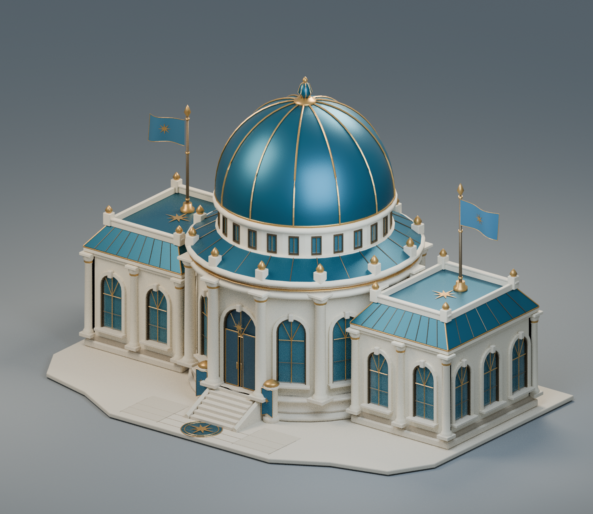
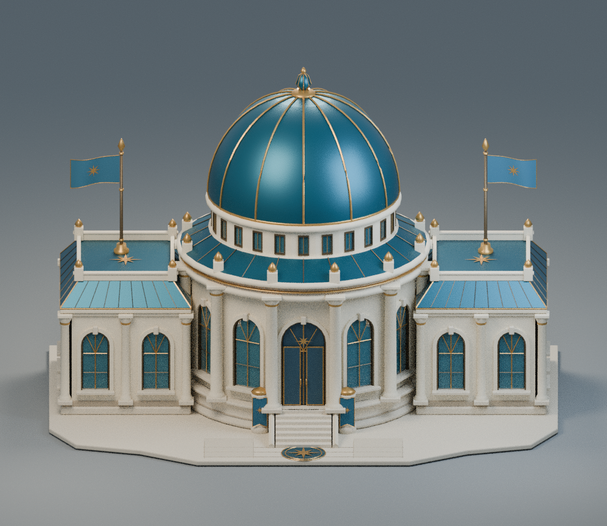
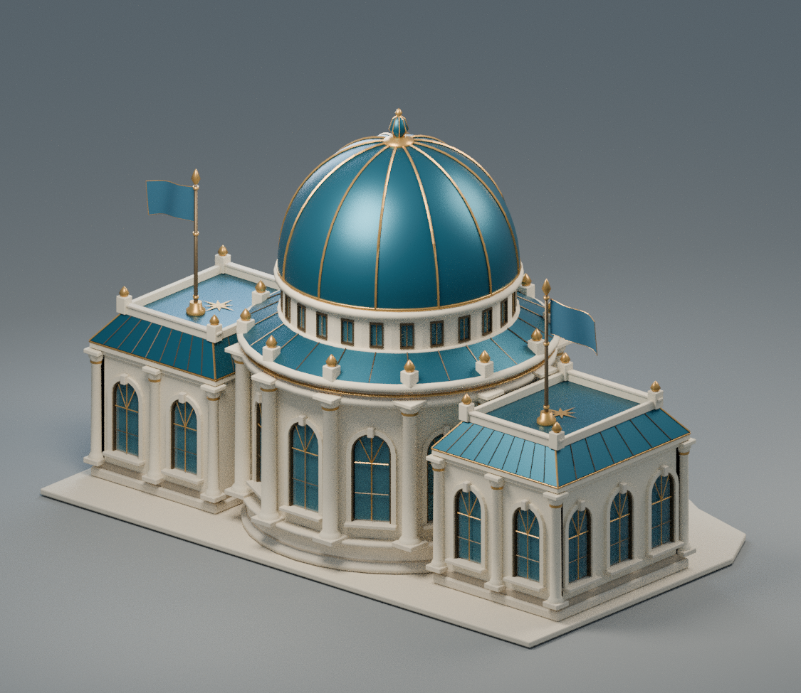
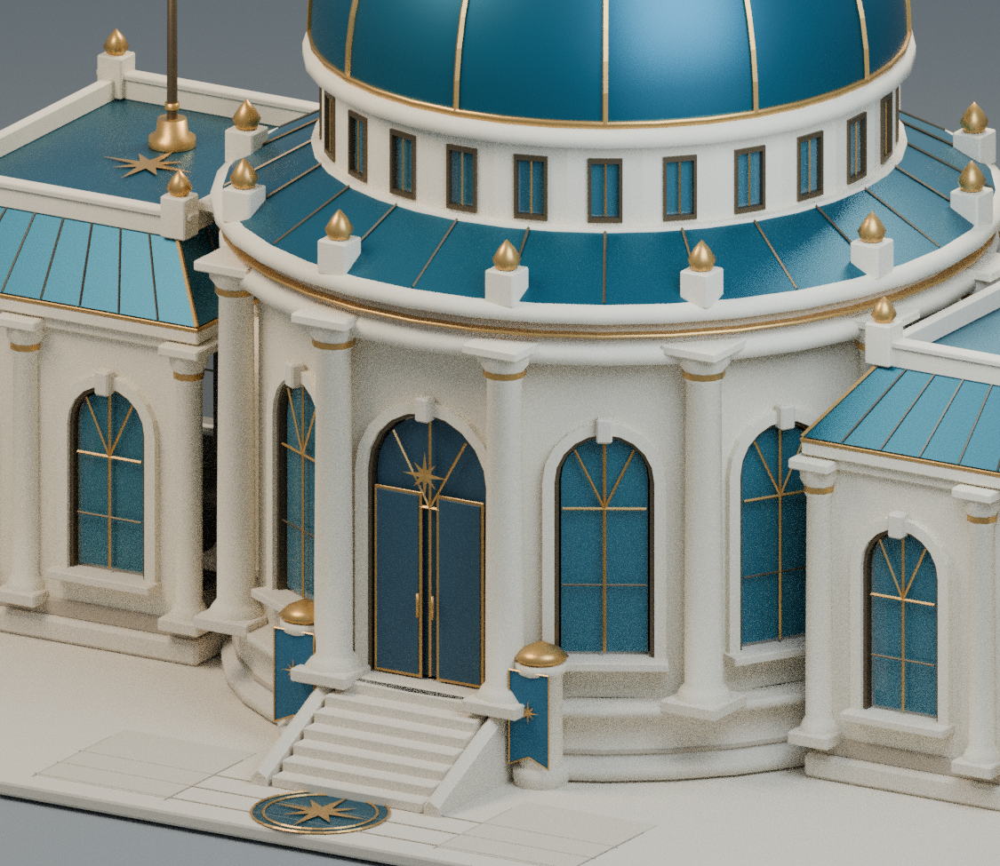

# Settlements Hall — original static delivery

This archive preserves the completed static model before the animation update.
It includes the editable Blender model, GLB, four previews, source and reports.

[Download the original ZIP](settlements_hall_asset_pack.zip?raw=true)

| Hero | Front |
| --- | --- |
|  |  |
| Rear | Entrance detail |
|  |  |

Individual previews: [Hero](hero.png) · [Front](front.png) · [Rear](rear.png) · [Detail](detail.png).

The repository is private; sign in with repository access to download.
No game runtime or deployment files are included in this publication.
