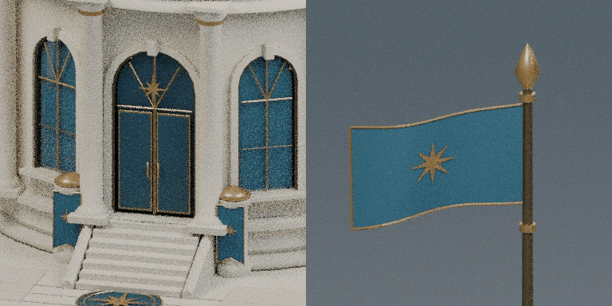
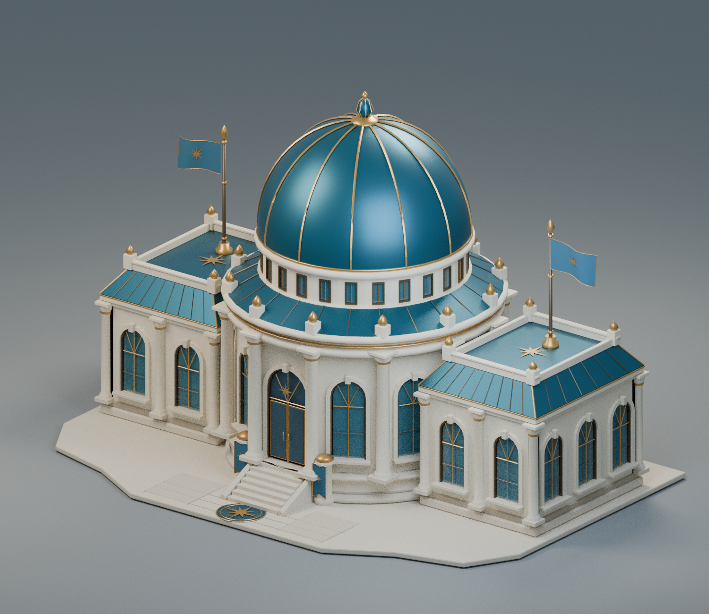
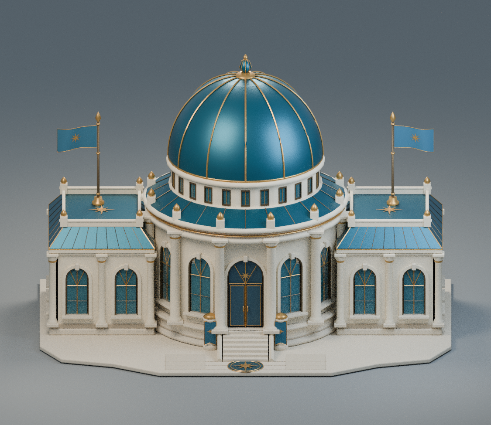
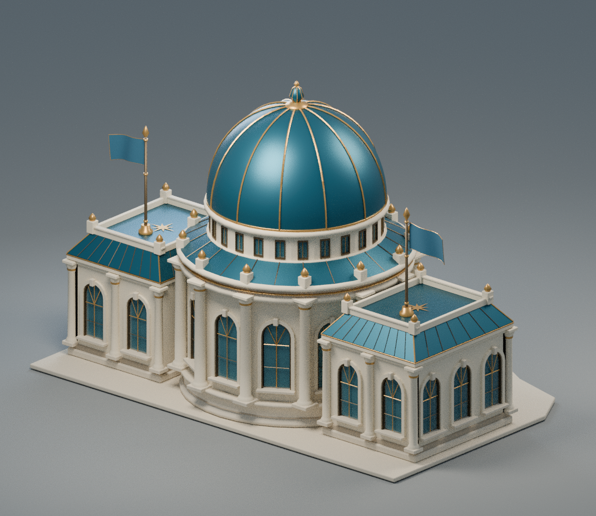
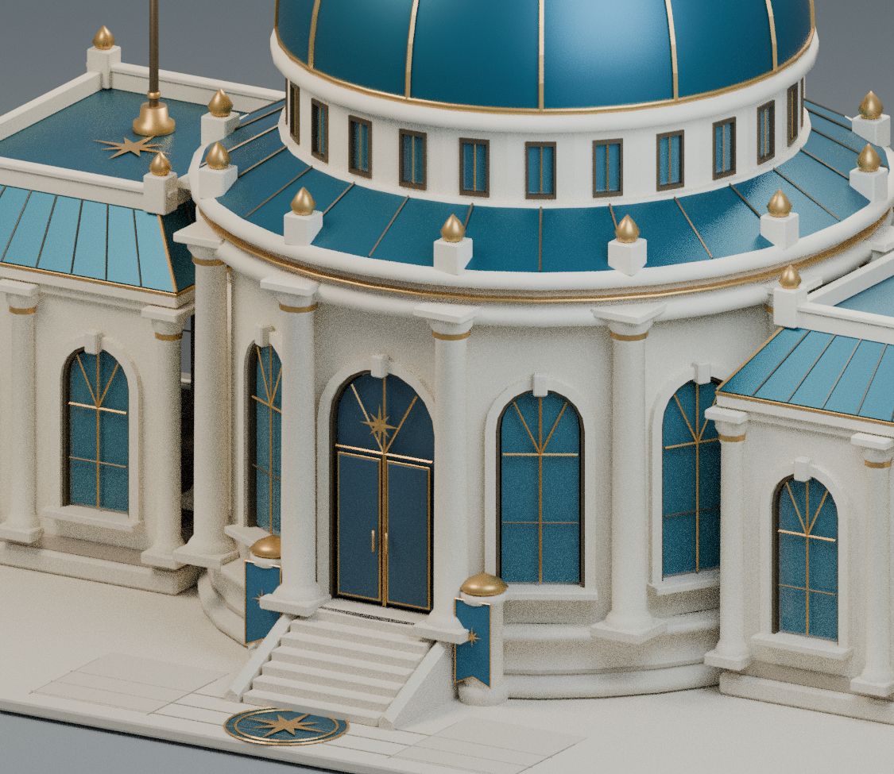

# Settlements Hall — animated delivery

[Download the complete ZIP](settlements_hall_asset_pack.zip?raw=true) · [SHA-256 checksums](SHA256SUMS.txt)

Contains editable Blender source, GLB, four PNGs, demonstration, reports, source
scripts and an independent Godot 4.6.3 inspection project. Sign in with repository
access to download from this private repository.

**34,643 triangles, 11 PBR materials, 18 meshes / 22 surfaces.**
The original architecture and materials are preserved.

## Animation demonstration

Left: independently hinged double doors opening 100° and closing.
Right: lightweight looping flag deformation, with pinned pole attachment.
Both panels are CPU renders after reimporting the exported GLB.

[MP4 download](animation_demo.mp4?raw=true) · [GIF](animation_demo.gif)

Four named clips survive GLB export: `Doors_Open`, `Doors_Close`,
`Flags_Wind-loop`, `Hall_Demo-loop`. Godot imports the suffix-marked clips as
looping `Flags_Wind` and `Hall_Demo`. Both roof flags and both entrance pennants
are separate animated objects. The optional wrapper supports independent wind
and door playback.

## Four architectural previews

| Hero | Front |
| --- | --- |
|  |  |
| Rear | Entrance detail |
|  |  |

Individual images: [Hero](hero.png) · [Front](front.png) · [Rear](rear.png) · [Detail](detail.png).

## Verification reports

- [Godot 4.6.3 actual playback verification](godot_animation_validation.json)
- [GLB geometry, materials and animation validation](glb_validation.json)
- [GLB round-trip pose samples and source hash](round_trip_animation_report.json)
- [Hand-edit export retains all animation clips](hand_edit_export_validation.json)
- [Asset statistics](asset_stats.json) · [File hashes and source commit](deliverable_manifest.json)

Godot verifies the two 100° hinges, closing poses, all four morph-animated fabrics,
matching loop endpoints, independent playback, glass and collision shapes.
No current-game modification or deployment is part of this delivery. Web and
physical-device performance were not measured. The original static delivery is
retained separately under `../v1-static/`.
