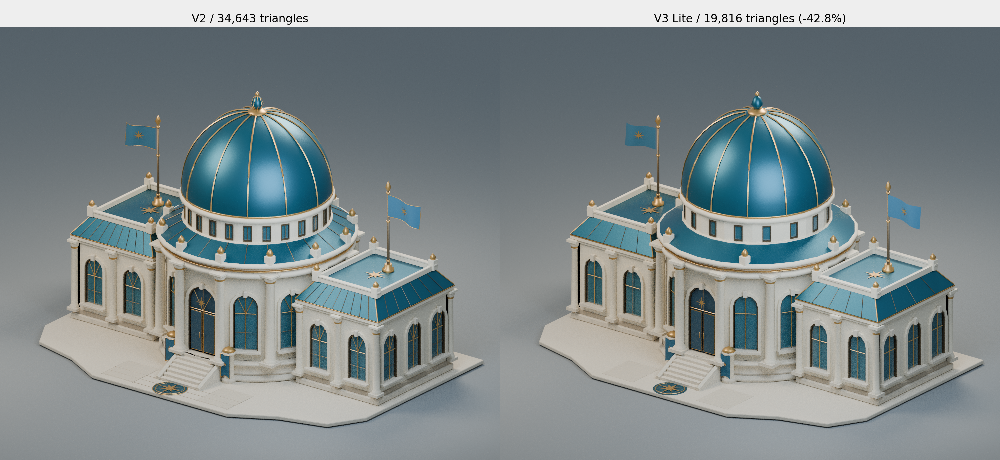
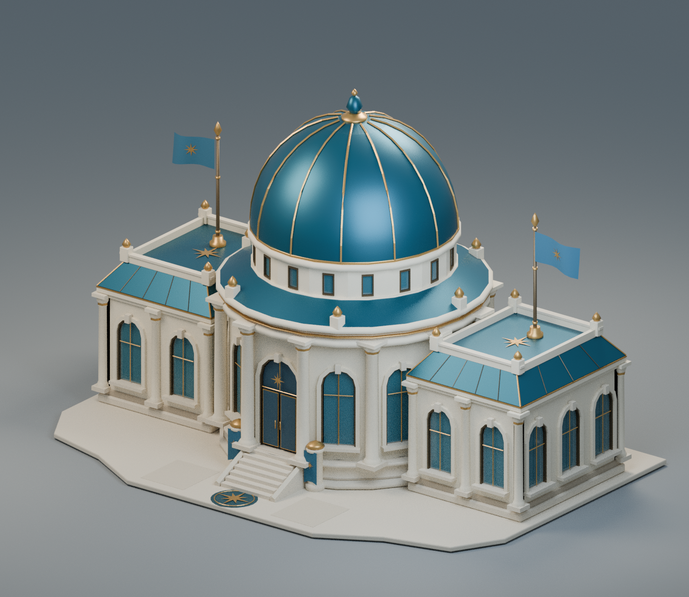
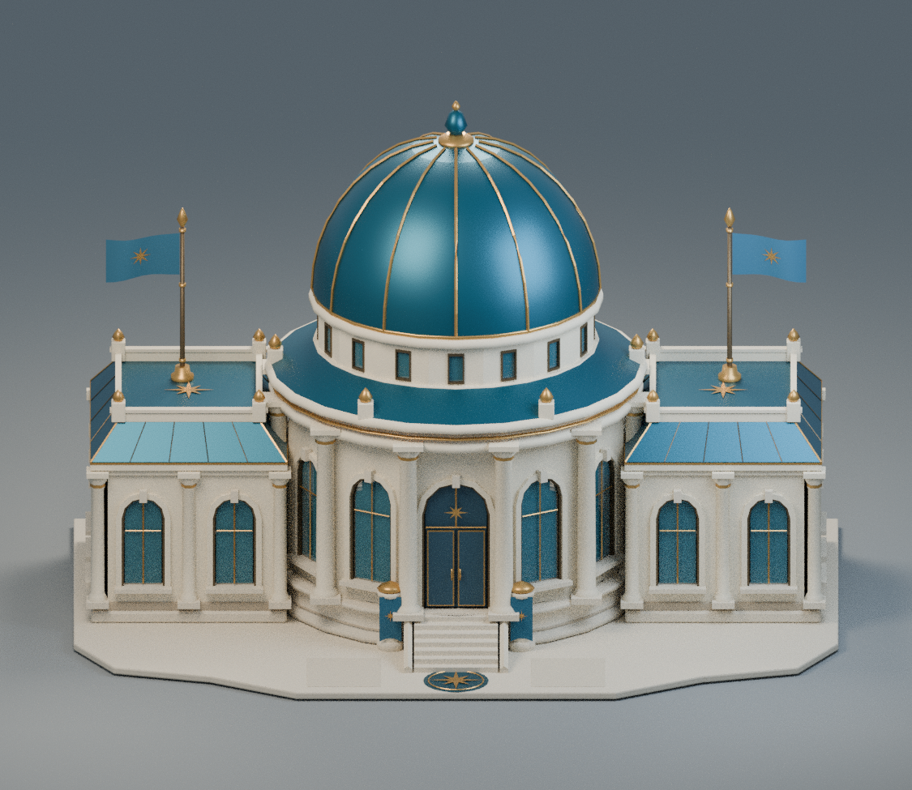
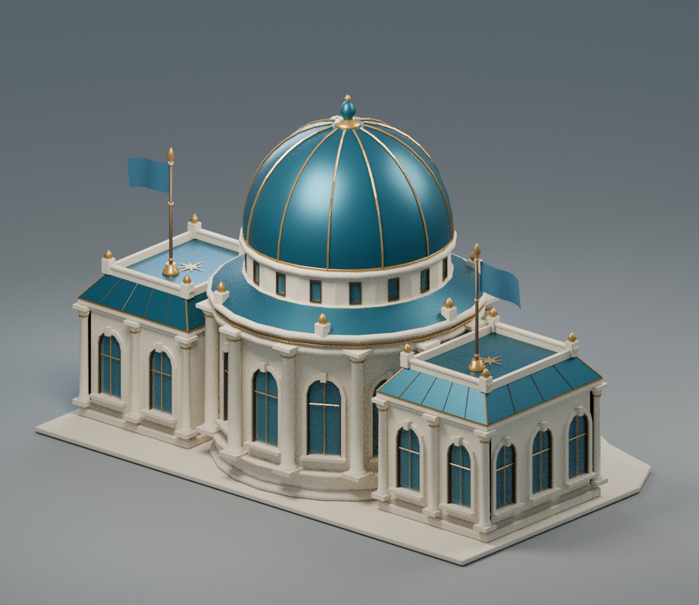
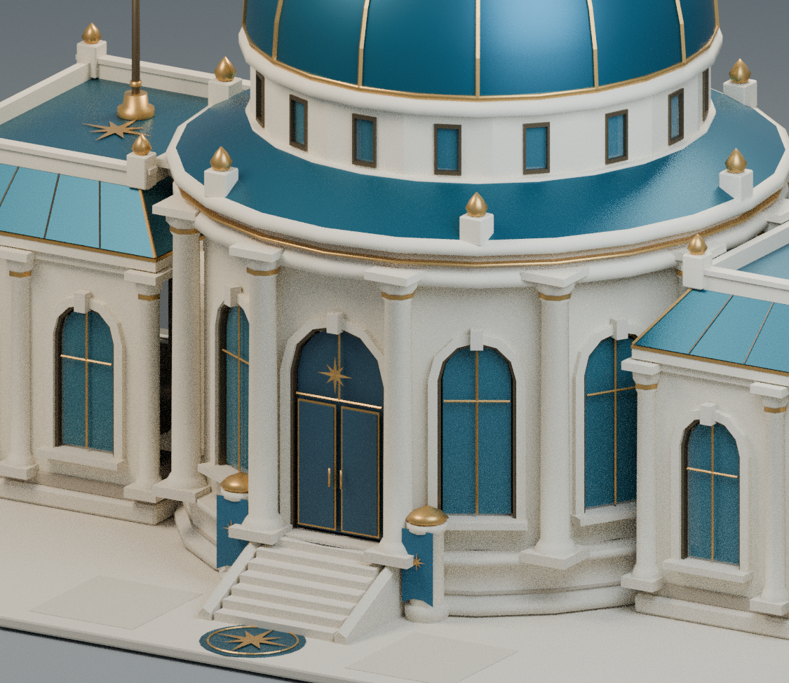
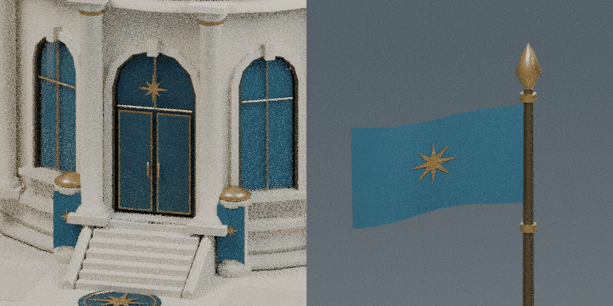
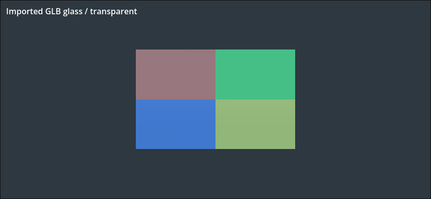

# Settlements Hall V3 Lite

**19 816 треугольников — на 42,8% меньше V2.** GLB: 1,11 МБ, на 46,9% меньше.
11 исходных PBR-материалов, 18 мешей / 22 поверхности и четыре клипа сохранены.

[Скачать ZIP](settlements_hall_v3_lite.zip?raw=true) · [Blender .blend](settlements_hall.blend?raw=true) · [Godot .glb](settlements_hall.glb?raw=true) · [SHA-256](SHA256SUMS.txt)

ZIP включает редактируемый источник, GLB, четыре рендера, GIF/MP4, отчёты и
самостоятельный Godot viewer. В архиве ровно один GLB: загрузчик выберет Lite.
Доступ к файлам приватного репозитория требует входа в GitHub.

## Сравнение с V2

Слева — оригинальная V2, справа — V3 Lite. Камеры, свет и масштаб совпадают.

Все пары: [Hero](comparison_hero.png) · [Front](comparison_front.png) · [Rear](comparison_rear.png) · [Detail](comparison_detail.png).

Купол, 12 рёбер, все фасадные окна и 24 колонны, вход и лестница сохранены.
Упрощены мелкие профили и орнамент, арки, повторения верхнего барабана.
При близком рассмотрении эти различия видны; на игровых ракурсах силуэт
и характер архитектуры сохранены. Габариты отличаются максимум на 3,2 см.

## Отдельные рендеры Lite

| Hero | Front |
| --- | --- |
|  |  |
| Rear | Detail |
|  |  |

[Hero](hero.png) · [Front](front.png) · [Rear](rear.png) · [Detail](detail.png).

## Анимация

[MP4](animation_demo.mp4?raw=true) · [GIF](animation_demo.gif).
Две створки открываются независимо на 100°. Все четыре полотна сохраняют
по три морф-цели и зацикленный ветер. Клипы: `Doors_Open`, `Doors_Close`,
`Flags_Wind-loop`, `Hall_Demo-loop`.

## Godot 4.6.3 и отчёты

- [Геометрия, материалы и клипы GLB](glb_validation.json)
- [Сравнение бюджета с V2](lod_comparison.json)
- [Реальное проигрывание дверей и всех четырёх полотен](godot_animation_validation.json)
- [Godot Compatibility / WebGL: стекло по пикселям, позы, viewport и замеры](godot_visual_validation.json)
- [Камеры и свет](camera_lighting_comparison.json) · [Материалы и рендеры](render_comparison.json)
- [Экспорт ручных правок с сохранением анимаций](hand_edit_export_validation.json)
- [Демонстрация после GLB-reimport](round_trip_animation_report.json) · [Manifest](deliverable_manifest.json)

Контроль: [без стекла](godot_glass_hidden.png) · [непрозрачное](godot_glass_opaque.png).
Цветовой фон виден сквозь импортированный материал; измеренное смешивание
0,627–0,631 соответствует альфе 0,63.

Реальные кадры Godot: [V2](godot_v2_844x390.png) · [Lite](godot_lite_844x390.png) · [анимационная поза](godot_lite_animation_pose.png).
Web-проверка выполнена в Chromium/SwiftShader, 844×390, на существующем
движке Godot 4.6.3. Это не физический Safari и не подтверждение мобильной
производительности: программный рендер дал около 3 FPS в обоих вариантах;
JS heap не является полной памятью устройства, замеры разделяют прогретый кэш.

Оригинальная V2 остаётся в `../v2-animated/` без изменений. Основная игра, её
ресурсы и публикация не изменены. Новые ветки, PR и инфраструктура не создавались.
