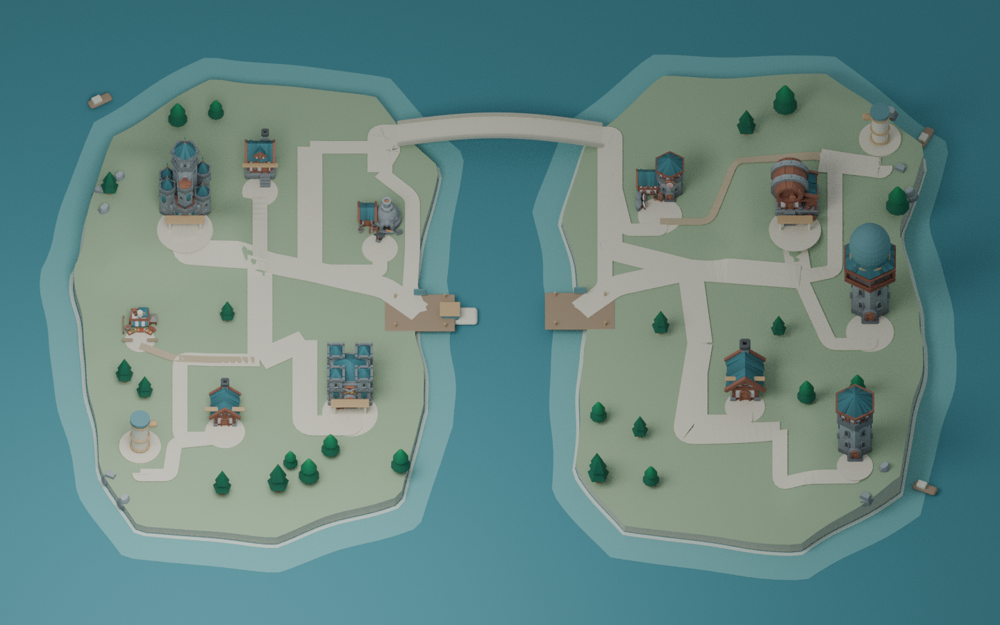
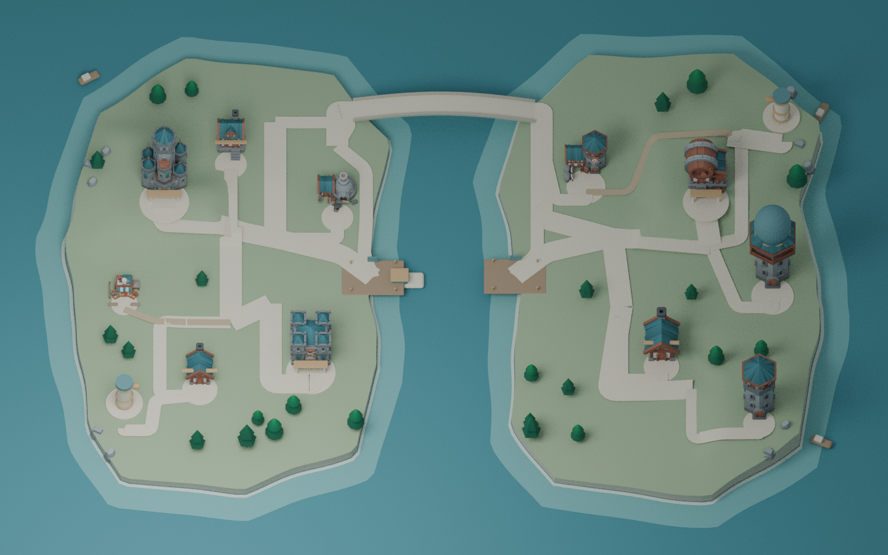
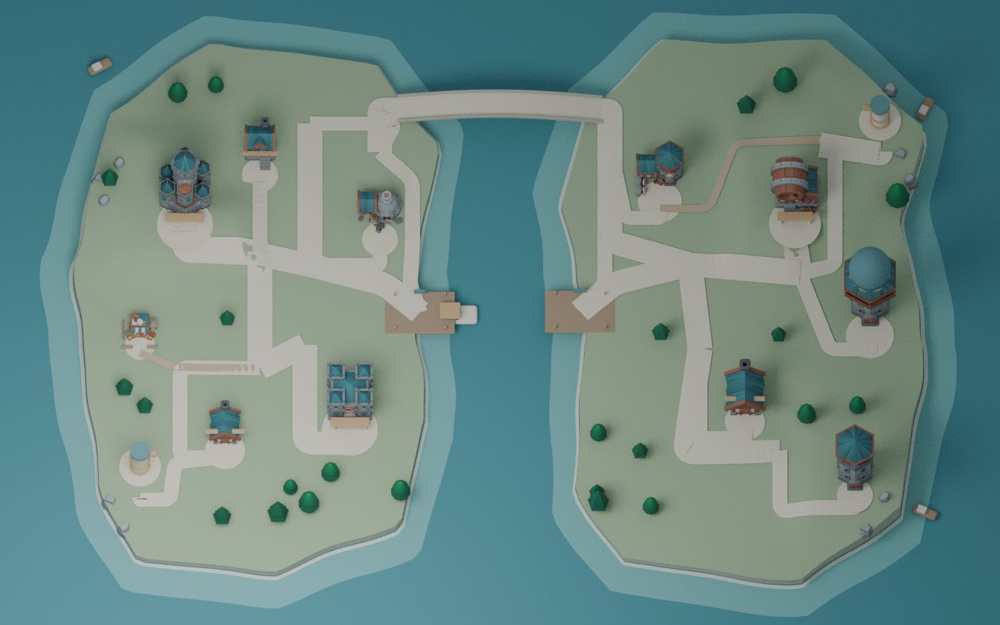
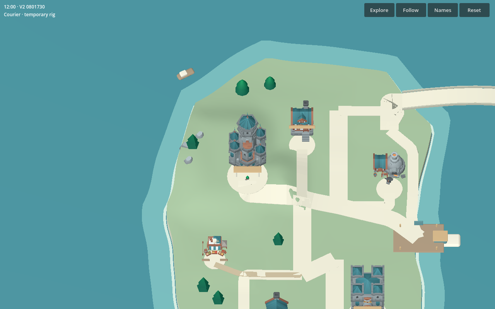
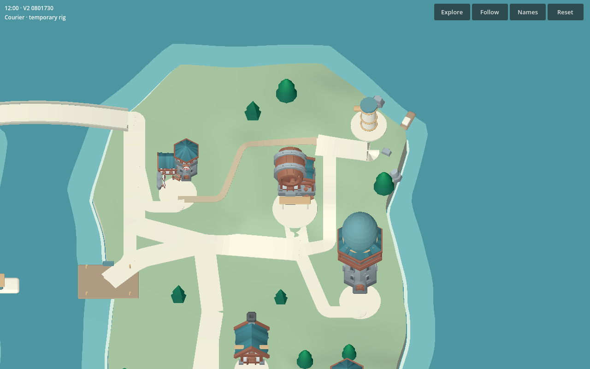
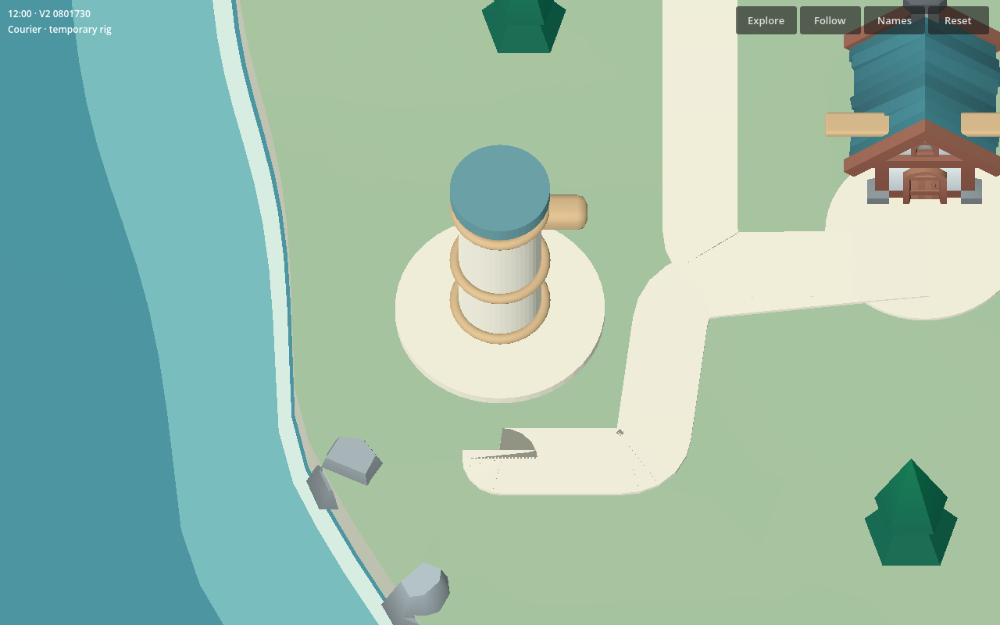
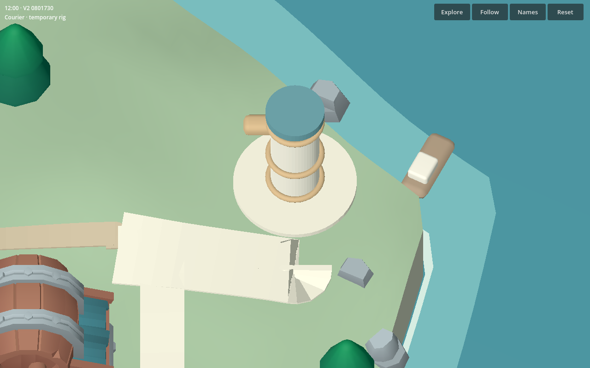
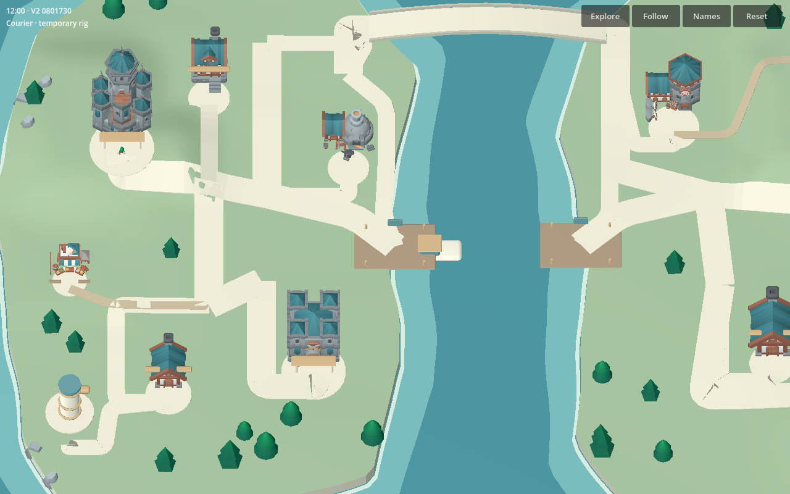
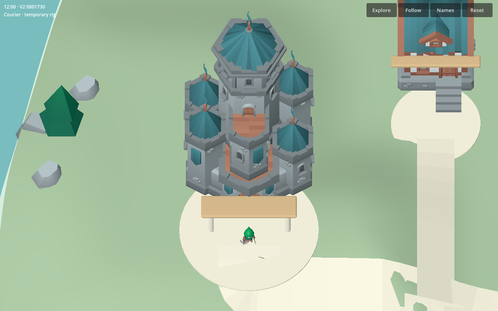

# Telanico overworld V2

This is an asset-first playable layout pass. The old 170/2.5 × 115/2.5 smoke layout has been enlarged to approximately 170 × 115 world units, with open lawns, continuous height fields, raised institutional pads and rocky coasts. The art-director image informs teal/ivory/bronze hierarchy and island composition; its ornate buildings are not copied. Fourteen distinct licensed mesh models replace the cube-only architecture/nature language. The web scene uses Compatibility, modest texture size, one sun and no real-time browser shadows.

## Original pilot correspondence

Read-only reference: original VorGun `main.gd` travel-system construction, SCENARIO.md, DECISIONS.md and navigation regression tests. Original walking speed is **1.5 pilot units per story minute**. V2 correspondence scale is **6.25**, giving **9.375 world units per story minute**. Routes charge `ceil(physical 3D path length / 9.375)`. Demo walking speed is 3.125 world units per real second: roughly three real seconds per story minute, with rounding and corners adding a little. The clock starts at noon. Green ~90, yellow ~110 and red >120 minutes remain scenario references; no full invoice/quest route is simulated here.

West: Settlements Hall, Operations, Trade Finance, separate LC Desk, Compliance Annex, Coffee Area, west tube and west dock. East: Trader/Eagle, Contracts, VAT/Tax, FX, Archive Rotunda, east tube and east dock. This intentionally follows the original pilot and TASK1 canonical Operations assignment. Both tube stations share one visual grammar and occupy opposite outer diagonal corners, over 150 units apart. Inner docks face the central channel. There is one northern pedestrian bridge; central ferry is a separate faster crossing. Three small coastal boats are decorative.

Stone promenades form a sparse readable circulation skeleton. Smaller stone paths reach department entrances; two gravel trails provide local alternatives. No asphalt or car street exists. Important hubs sit on raised terrain; outer terrain retains broad rolling hills. Building pads are flattened with blended ten-unit approaches, preventing artificial steep ramps.

## Navigation contract

A constrained, bidirectional Dijkstra graph is the equivalent navigation system used here. Every edge is densely sampled from the same analytic surface used to generate visible walk meshes; it is not a straight-line move-to implementation. Tests sweep every sample against island polygons and expanded building rectangles and enforce slope limits. Ground taps snap only within six units of a real path; virtual waypoints are linked along the original edge. Water taps never create a route across the channel.

A CharacterBody capsule follows successive samples, with wall collisions and walk-surface collisions. Terrain is a separate selection layer: grass triangulation cannot introduce an invisible curb through a paved route. A collision-tested 0.85-unit step assists small mesh seams; it cannot bypass a building wall. The character has real Idle/Walking clips and arrives at a separate entrance outside the building. Enter opens a placeholder; Stay Outside resumes exploration. Navigation is intentionally limited to authored paths, not free roaming over every lawn.

Walk preview requires confirmation and can be cancelled without charging time. Bridge travel between dock nodes is approximately 15 story minutes, versus ferry 5 and tube endpoint transfer 3. Access walking is charged separately. Ferry visibly carries the actor across the middle channel; tube is an explicitly special fade transfer. This prototype uses zero boat waiting time; original timetable waiting is deferred. Clock charges on completed legs. Interiors, dialogue, invoice/quest rules, final Cooper art and production scenario timing remain out of scope.

## View and evidence

Default is north-up Explore at 60 degrees: drag pans, pinch/wheel zooms, Follow tracks the courier, Reset restores overview. Inspect enables constrained desktop right-drag orbit/tilt. Names are opt-in with overlap displacement; hovering gives a single name. The accepted Safari visualViewport/safe-area shell is preserved. Simulated mobile tests do not replace a physical iPhone Safari test.

Private Actions artifacts include source Blender scenes, self-contained world/character GLBs, layout JSON, browser screenshots and test logs. Asset budgets are enforced by `validate_v2.py`; the current world is roughly 83k position vertices, well below 300k. One composed variant was developed instead of splitting effort across alternative maps.

## Runtime close-ups

These are actual V2 WebGL development-build captures (HUD identifies their source commit), not concept mockups. Final release identity is verified separately by the publisher.

