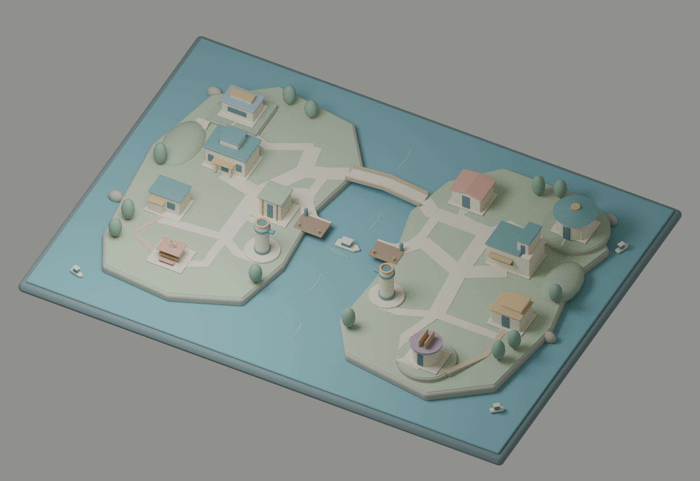
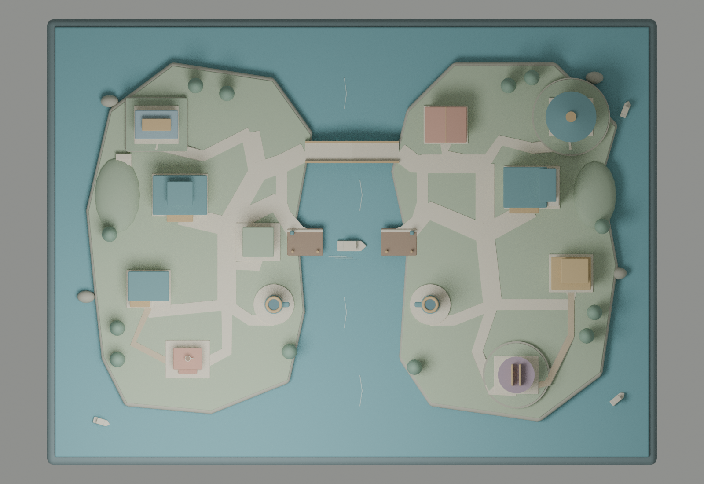
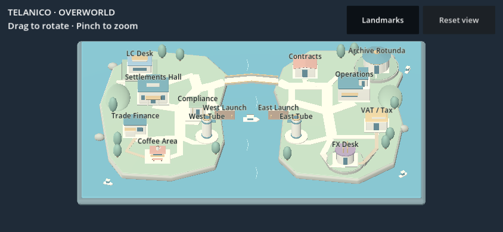

# Telanico overworld — first composition pass

A spacious pedestrian campus on two elongated islands. The west island has a
more formal civic spine; the east uses looser terraces and an isolated southern
FX pavilion. This is one primary layout, combining clear structure with gentle
terrain, rather than two partially finished variants.





## Composition and identity

| West: settlements & support | East: operations & documents |
| --- | --- |
| Settlements Hall: main pavilion and portico | Operations: broad mass with dispatch lantern |
| Trade Finance: two linked ledger volumes | Contracts: paired open-folio roofs |
| Compliance: controlled portal with bronze fins | VAT / Tax: stepped ledger mass, ochre cornices |
| LC Desk: long clerestory on the north terrace | Archive Rotunda: circular roof, ribs and oculus |
| Coffee Area: terracotta canopy, cup and bench | FX Desk: detached round pavilion with twin fins |
| Matching tube station, south-inner edge | Matching tube station, south-inner edge |
| Harbor Launch, central inner shore | Harbor Launch, central inner shore |

Muted ivory, deep teal and bronze tie the map together. Department identity comes
from massing and roof profiles, with limited ornament. Twelve trees, low hills,
coastal ledges and three raised terraces leave the courtyards open. There are no
interiors, downloaded asset packs, asphalt, vehicle streets or quest scripts.

The north bridge is the only land crossing. Its detoured approaches make it the
slow connection. Both docks face the **middle of the channel**, and the ferry
sits between them. Three smaller boats are spread along outer coasts. The paired
pneumatic towers face inward and share the same geometry recipe; their connection
is symbolic, with no second bridge or pipe obstructing the channel.

Primary promenades are 2.4 units wide, secondary stone paths 1.4, and dirt/gravel
shortcuts 0.85. Terrace approaches rise gradually, supported by retaining wedges.
The FX branch stays separate from the main east promenade to reserve later route
choices. This blockout uses roughly 206 meshes and 30k exported vertices, with a
260-mesh / 100k-vertex test ceiling. Materials are flat colors without textures.

## Travel calibration, not a simulation

The geometry spans about 68 × 46 world units before the water tray. A walking
edge is provisionally costed at **0.36 story minutes per world unit**. The
reproducible `overworld_layout.json` records route points, hierarchy, lengths and
illustrative costs; it does not move a player or implement travel/quest timing.

| Representative walk | Illustrative minutes |
| --- | ---: |
| Settlements Hall → Compliance | 5.8 |
| Settlements Hall → LC Desk | 11.6 |
| LC Desk → Trade Finance | 16.8 |
| Operations → VAT / Tax | 9.9 |
| Archive Rotunda → FX Desk | 16.4 |
| West civic hub → east civic hub via bridge | 17.0 |
| Central dock → central dock via bridge | 15.9 |

Short waterfront promenades make the bridge route from the same central docks
about **15.9 minutes on foot**. Boat travel is a **7-minute dock-to-dock design
allowance**, including boarding;
the tube allowance is **2 minutes station-to-station**. Walking to either connector
is additional and varies with the origin. These figures deliberately compare
specified endpoints, not every possible department pair. The green ~90, yellow
~110 and red >120 minute scenario budgets remain reference targets. Without the
pilot itinerary/dwell times, this pass does not claim to reproduce those totals.

The original pilot map and latest concept image were not present in the available
repository or chat attachments. The user's explicit island assignments and
travel hierarchy therefore drive this layout; no missing reference was recreated
or copied from the production game.



## Reproduce and review

```bash
blender --background --factory-startup --python-exit-code 1 \
  --python blender/scripts/build_overworld.py
python3 tools/validate_overworld.py
python3 tools/validate_glb.py godot/assets/generated/overworld.glb
# Optional CPU review images (24 samples, no GPU or external assets):
blender --background --factory-startup --python-exit-code 1 \
  --python blender/scripts/build_overworld.py -- --render
# Full Web pipeline, with matching Godot templates installed:
bash tools/build_web.sh
```

Outputs: `blender/generated/overworld.blend`,
`godot/assets/generated/overworld.glb`, and
`blender/generated/overworld_layout.json`. Generated models remain ignored.
Review PNGs are committed intentionally so the PR can display them.

The Godot preview frames the whole world, preserves drag/pinch/reset, and adds a
**Landmarks** toggle for 14 projected screen-space labels. This is a viewable blockout, without
player movement, navigation meshes, collisions, boat animation or tube transport.
Future work should test walkability and device performance before adding props.
